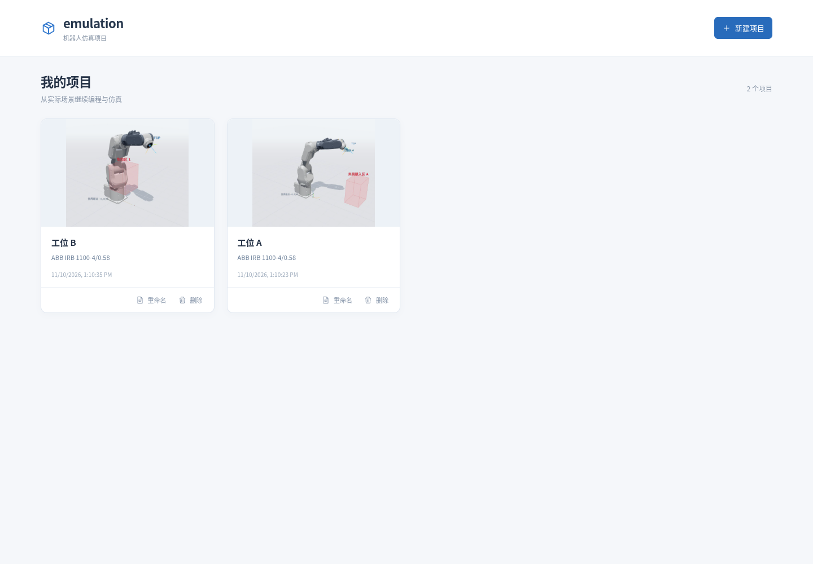
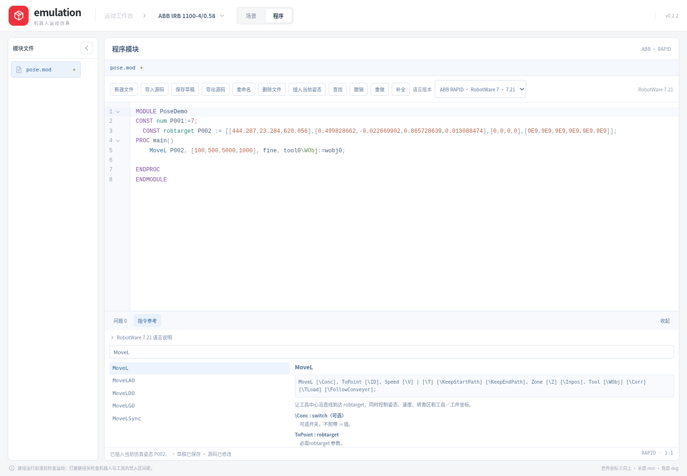

<div align="center">
  <h1>Emulation</h1>
  <p>原生机器人运动工作台 · 仿真轨迹与控制器程序</p>
</div>

桌面客户端使用 **Tauri 2 + Rust + Three.js**：系统 WebView 与 GPU 负责界面和三维显示，Rust 后台负责正逆运动学、配置判断、路径规划和程序生成。安装后无需用户安装 Node.js、Rust、Python 或启动本地服务。

在场景中创建 Path，调整机器人姿态后右键向 Path 添加当前点，再右键选择“运行”启动仿真。支持六款 ABB、FANUC、Yaskawa 型号，目标点和转换生成的独立模块采用对应品牌格式；Path 支持循环运行和随时停止。程序页另提供各型号独立的离线源码编辑、高亮、补全、指令说明和语法诊断，可导入与保存明文源文件；具体语言覆盖见[离线编程](docs/offline-programming.md)。

机器人基座默认在世界原点，也可挂接到参考坐标系。项目复用现成的 IRB 1100 分段 CAD 网格，尺寸、机械零位、关节正向与运动范围按 ABB 官方资料校验。


上图为工作台的浏览器参考视图；客户端沿用此界面，运动和端点检查使用 Rust 原生引擎。

工作台固定占满窗口，只有局部面板滚动。左侧显示参考坐标系、机器人及各关节轴／法兰、工具、工件模型、禁入区和 Path 对象；右侧随选择显示各自的坐标、姿态、参数和操作。顶部居中的“场景／程序”共用机器人、对象和程序数据，项目机器人型号显示在右侧。视图分工及后续仿真／编辑接入方式见[工作区架构](docs/workspace-architecture.md)。

## 客户端

正式安装包见 [最新 Release](https://github.com/ecojust/emulation/releases/latest)。每个平台附带源提交、CPU 架构和 SHA-256 清单；发布流程先检查同一源码提交的完整测试与实际安装结果，再校验上传文件。

**v0.5.0 下载：** [macOS M系列](https://github.com/ecojust/emulation/releases/download/v0.5.0/Emulation_0.5.0_aarch64.dmg) · [Windows x64](https://github.com/ecojust/emulation/releases/download/v0.5.0/Emulation_0.5.0_x64-setup.exe) · [更新说明与校验文件](https://github.com/ecojust/emulation/releases/tag/v0.5.0)。本版新增STL／OBJ／GLB工件导入、表面区域点选和按毫米间距生成UV路径，并修复Jog后右键示教的姿态保持，调整固定项目型号与顶部布局。

构建源为`e5bcd2c`，已通过[完整检查](https://github.com/ecojust/emulation/actions/runs/42927486388)及[ARM／Windows实际安装验证](https://github.com/ecojust/emulation/actions/runs/42927486372)，包括原生规划／端点／网格／表面生成、GP7下载和缓存、真实封面及跨型号项目恢复。发布后已下载全部公共资产并核对SHA-256与来源清单；Intel本次没有完整验收通过的产物，暂未提供该安装包。

- macOS 13+：当前提供 Apple Silicon（ARM64）安装包。使用 ad-hoc 完整性签名，未做 Apple Developer ID 公证，首次打开可能需要系统的安全确认。
- Windows x64：安装程序会检查系统 WebView2 运行时；缺少时由内置引导程序安装，可能需要联网。
- 两款 IRB 1100 网格随客户端打包；FANUC、Yaskawa 型号首次选择时下载，校验后缓存，之后可离线使用。运动求解与程序生成在本机执行。

开发客户端需要 Node.js **22.12+**（推荐24）、Rust stable，以及 macOS Xcode Command Line Tools 或 Windows Visual Studio C++ Build Tools。

```sh
npm ci
npm run desktop:dev
```

在对应系统上生成安装包：

```sh
npm run desktop:build
```

桌面求解只调用Rust；IPC失败时显示错误，不静默切回JavaScript。后台只有一个计算线程，运动／导出、端点逆解、干涉检查各有一个有界等待槽，前台优先；自动检查不会取消用户的求解或导出。编辑对象会取消过期任务。

## 浏览器参考模式

需要 Node.js **22.12+**（推荐 Node.js 24）及支持 WebGL2 的现代浏览器；macOS 和 Windows 使用相同工程。

```sh
npm ci
npm run dev
```

打开终端输出的本地网址，默认 `http://localhost:5173`。浏览器模式保留 TypeScript 参考求解器，供演示和迁移对照，其性能不能代表 Rust 客户端。桌面版以 Rust 执行同样的 Path 逐段规划流程。

生产构建与本地查看：

```sh
npm run build
npm run preview
```

`dist/` 可以部署到静态服务；网格SHA-256校验使用Web Crypto，远程访问需HTTPS，本机可使用localhost。由于使用模块和Web Worker，不直接双击HTML文件。

## 使用流程

以下说明对应当前源码；已发布安装包的功能以相应 Release 说明为准。



1. 在主页点击“新建项目”，填写名称并选择机器人；项目卡片可打开、重命名或删除。机器人型号在创建项目时确定，编辑区只显示型号；使用其他机器人需新建项目，未缓存的型号首次下载并校验。两款 ABB IRB1100 使用各自的 DH，FANUC CRX-10iA/L、R-2000iB/165F 与安川 GP7、GP110 使用各自的 URDF 六轴链，详情见[型号目录](docs/robot-catalog.md)。
2. 左侧选择机器人，右侧查看当前工具坐标、姿态、关节与型号参数。展开机器人可选择六个关节轴或法兰；全部六款型号支持 TCP Jog 和关节坐标系。ABB 显示 robconf 和标称 DH，FANUC／安川显示各自 URDF 参数，不套用 ABB 配置。
3. 在场景左侧点击“添加 Path”，然后右键 Path 选择“添加当前点到 Path”。打开右键菜单不会选中 Path 或重置刚刚 Jog 到的机器人姿态。每次调整机器人后都可继续添加；点保存当时的姿态和速度，随后移动机器人不会改变这些快照。
4. 展开 Path 选择点，右侧显示位置、姿态和品牌数据；各型号点面板均提供多解、临时姿态预览和实际网格干涉检查，ABB 另显示配置。点右键“移动至此”可查看记录姿态，支持中途停止。端点候选解的“预览”仅临时改变三维显示，不改写原始点或程序；退出预览恢复原姿态，右侧面板保持滚动位置。确认候选解后可点击“用当前姿态更新点”，只更新该点的关节与轴配置，保留其位置、方向和速度；生成过的模块源码不自动改写。
5. 右键 Path 选择“运行”，或选中 Path 后在属性中点击“运行 Path”。全部运动段通过规划后，机器人只按此 Path 的点顺序运动；“循环运行”还会检查末点回首点。失败保留原姿态，停止保留当前显示姿态。删除点后可保留空 Path；删除整个 Path 会提示确认并清理所属点。
6. 右键 Path 选择“转换为程序”，创建当前品牌和控制器版本对应的新模块并进入程序工作区。左侧列出当前型号所有模块，中央编辑所选文件。重复转换自动使用新文件名，已有模块和原 Path 均保留；没有程序转 Path 的反向操作。

需要空间层级时，添加“参考坐标系”或“工具”：将机器人基座或整个 Path 拖到参考坐标系，将工具拖到法兰，也可在属性中的“挂接到”选择父级。换父级保持世界位置与方向；之后修改父级位姿会带动子对象。工具安装位姿和 TCP 偏置分别设置，避免把工具中心点当作法兰。

需要打磨路径时，右键 Path 选择“路径规划”，输入每行 `X Y Z qw qx qy qz` 的世界目标点，指定速度和最小安全间距。每个输入target的位置和姿态均保留，规划器选择连续关节解，避免突然翻腕或换分支；ABB的配置象限可以随连续关节运动正常变化。先生成并预览，确认后“应用到路径”；输入或环境变更会使旧结果失效。打磨检查使用当前型号、基座、工具包络和禁入区，失败不会覆盖原 Path。名称、坐标变换与检查边界见[参考坐标系、工具与打磨路径](docs/frames-and-grinding.md)。

项目保存关节姿态、坐标层级、工具、工件网格、表面区域、Path、禁入区和模块源码。项目文档使用格式 2，兼容读取格式 1，并在下次正常保存时升级；v0.4.1 及更早客户端会拒绝新格式，防止丢弃工件数据。点击左侧面包屑中的“主页”会先保存模块和场景，再从实际三维渲染更新项目封面；从程序页返回也会生成当前场景的封面，临时端点预览不会写入。原生窗口正常关闭时也保存场景，封面保留到下次返回主页更新。旧版本的模块草稿会恢复为独立项目。

场景对象均支持右键删除并确认；机器人只能删除整个本体，不能删除单个轴、基座或法兰。删除参考坐标系或机器人时，相关工具、路径解除挂接后保持世界位姿；已生成的模块文件仍保留。点面板用于查看和显式更新点、预览候选解，运动检查统一由 Path 运行完成。

程序页支持新建、导入、编辑和保存多文件源码，也可以直接在源码中插入当前姿态。生成或保存的模板未经过控制器验收；任意源码尚不能驱动仿真，源码修改也不会改变 Path。原文保留、语法检查和控制器程序验收的边界见[离线编程说明](docs/offline-programming.md)。



ABB四元数使用`[w,x,y,z]`顺序，欧拉角遵循`OrientZYX(Rz,Ry,Rx)`。端点逆解检查直接求当前robtarget的可用关节配置，不借助零距离运动伪装路径可达。

场景中的危险区为世界坐标下的方块，可自由新增、命名、选择、删除，并设置各自的中心XYZ、尺寸及启停（最多64个）。左侧对象选择联动右侧属性，选中的危险区可直接用世界XYZ操作柄平移。端点解旁的警告图标和“干涉”表示实际机器人网格与危险区接触、相交或实体包含，提示中列出区域和部件；包围盒只用于快速排除，重叠后继续检查真实三角面和闭合实体内部，桌面由Rust完成。原始模型部分部件存在缺口，无法确定内部关系时显示问号图标和“无法确定”，不会算作已通过。此网格检测入口覆盖目录内六款型号的候选端点（包括 R-2000iB 的平衡器支链），不代表整条路径已验证。打磨路径规划另行检查全段机器人／工具包络与禁入区，不执行自碰撞或完整环境工艺验证；详情见[网格检测与验证](docs/mesh-collision-validation.md)。

“机械零位”按钮仍可还原官方全零关节角。长臂型号在默认基座且未安装额外工具时，法兰位置为 `[364,0,617] mm`，轴5为0°，腕部处于奇异位置；当前规划器拒绝从该姿态直接开始MoveL或TCP Jog，这不代表目标位置本身不可达。点击“示例起始姿态”可回到非奇异的演示起点，它不是ABB官方推荐的实机安全位置。Jog用于调整仿真起点，拖动过程不会自动保存成可导出的整段轨迹。

## 手机示教器与主题

项目顶部“示教器”生成配对二维码，手机在同一局域网扫码后使用虚拟摇杆控制仿真机器人：线模式移动TCP，轴模式调整J1–J6，支持世界／工具坐标和速度倍率。松手、失联或切换模式会停止，返回主页结束连接；该功能作为独立模块实现。连接方式、运动边界和模块分工见[手机示教器](docs/mobile-pendant.md)。

主页与项目顶部提供明／暗主题切换并保存选择。界面采用弱化背景与高对比度文本／选中状态，三维场景和代码编辑器同步适配；切换不改变机器人姿态或相机。

## 工件表面与 UV 加工路径

1. 在场景左侧选择“导入模型”。支持 STL、OBJ 和 GLB；STL／OBJ 需选择原文件单位 mm 或 m，GLB 按标准使用米，导入后统一为毫米。网格随项目保存，重新打开项目不依赖原文件。右侧可修改工件的位置、姿态和可见性。
2. 新建一个 Path，右键选择“点选区域”，沿同一工件表面的区域边界依次点击；拖动鼠标只旋转视角，按 Esc 或“结束点选”完成。在边界点中标记 **4 个角控制点**，按边界顺序形成四边区域：角点 1 → 2 为 U 方向，1 → 4 为 V 方向。点选时可在角点之间记录更多边界点。
3. 右键 Path 选择“生成 UV 加工路径”，输入 U、V 方向的毫米间距，按需反转工具法向并设置相邻姿态角度上限。生成点按行往返排列，工具 +Z 跟随网格的插值法向；换行时保持滚转方向连续。间距以表面弧长为目标，边界最后一段可短于设定值；常规段误差超过 `max(0.05 mm, 较小间距的 1%)` 时拒绝生成。
4. 点击“生成路径”后，先计算表面目标，再按当前机器人、基座、工具和禁入区求连续关节解。全部通过后可“预览路径”，再“创建新 Path”；原区域保留，新 Path 可运行和转换为程序。失败或取消不创建半成品，也不修改原区域。

单个导入文件最多 20 MiB、10 万个三角形；项目最多 32 个工件、共 20 万个三角形，另有项目存储容量限制。参与生成的区域需有 4～256 个边界点，每条 UV 路径最多 256 个目标点。当前算法适用于能够投影为单一、不折叠区域的表面；孔洞、重叠表层、锐边或法向突变会被拒绝，可缩小区域后重试。修改边界、控制点、工件位姿或相关坐标／工具会使关联结果失效，需重新生成；已生成的独立模块源码保留。

**表面目标与机器人运动是两层验证。** 目标点取自真实网格三角面，求解保留其位置和方向，并检查关节连续性；这不保证曲面上的接触轨迹：相邻目标之间的直线 MoveL 弦线可能离开曲面。当前运动检查针对禁入区及机器人／工具包络，尚未认证与导入工件的碰撞、自碰撞或完整加工过程，也未经过实际控制器验收。

## 多品牌程序与性能

模型及运动求解、品牌中立轨迹数据、控制器后处理器分别实现。后处理输出 `ProgramBundle`，能表示 KUKA 等控制器需要的多文件程序。

| 品牌 | 目标格式 | 当前状态 |
| --- | --- | --- |
| ABB | RAPID `.mod` | 两款 IRB1100、RAPID 仿真模板；Rust 保留单段已验证 MoveL 后处理 API |
| FANUC 发那科 | `.ls` | 两款 URDF 六轴 Jog／多逆解／网格检查、直线仿真与 LS 模板；控制器导出待适配 |
| KUKA 库卡 | `.src` + `.dat` | 接口已预留，型号／S/T／KSS 适配未实现 |
| YASKAWA 安川 | INFORM `.jbi` | 两款 URDF 六轴 Jog／多逆解／网格检查、直线仿真与 INFORM 模板；控制器导出待适配 |

模板中的控制器专用字段在缺少资料时保留明确占位，不猜测 FANUC 配置或安川脉冲比例。程序页保存源码原文；独立单段检查、播放、复制与导出界面已移除，Rust 单段规划与 ABB 后处理 API 保留。模板与控制器文件导出分开，详见[品牌模板](docs/program-templates.md)和[程序格式与扩展](docs/program-formats.md)。

同机 release 基准中，当前 Rust 逆解中位约78 µs（旧 TS 约245 µs），35 mm MoveL 约276 µs（旧 TS 约2.1 ms），自动方向搜索代表路径约21.5 ms（旧 TS 约238 ms）。改善包含原生编译和分配／搜索优化，不是只比较语言；这些是内核耗时，不含桌面 IPC、GPU 渲染或实际机器人周期。完整环境、原始批次和可复现命令见[性能记录](docs/performance.md)。

## 模型与运动学

- 官方几何来源：ABB 产品规格 **3HAC064993-001**；标准 DH 按其标称几何和关节约定推导。完整参数、零位及官方工作空间核对见 [机器人参数](docs/robot-model.md)。
- 现成外观来源：[Workr Robot Asset Library](https://github.com/work-r-labs/robots)，保留集合与源包MIT声明。两种型号分别包含基座和六个关节部件；原始字节、固定版本与校验值见 [模型资源说明](docs/model-assets.md)。这些是社区分发的现成资产，并非 ABB 官方认证的仿真包。
- RAPID／配置依据：ABB 技术参考 **3HAC050917-001**，包括 `confdata`、四元数、`robtarget`、`ConfL` 与 `MoveL`。详见 [RAPID 与配置约定](docs/rapid.md)。
- 场景使用右手坐标系，世界 Z 轴向上；基座默认在 `[0,0,0]`。公开位置单位为 mm、关节角为度，四元数为 `[w,x,y,z]`。底层运动学使用各型号基座到法兰的链；工作区通过参考坐标系和工具 TCP 偏置完成世界／局部变换。场景挂接不代表厂商控制器的工具与坐标表已经配置。
- IRB1100的正运动学、逆运动学和显示姿态使用同一条DH链；现成网格从各自的共同机械零位坐标变换。新增目录型号按各自URDF树、visual origin和mesh scale显示，不共用ABB的DH或控制器参数。
- 解析逆解适用于这里的两款 IRB 1100；自动姿态先尝试保持起始方向，再搜索有限组方向，结果不宣称全局最优，也不是任意 DH 表的通用求解器。
- 直线路径按不超过 5 mm／2° 的间隔采样，检查关节限位及连续性；ABB 另检查 cfx。通用六轴链使用解析雅可比与阻尼最小二乘数值逆解，逐点保持 TCP 直线和最短四元数弧，并核对最终关节与记录点一致。相邻采样任一轴变化超过 15° 时保守拒绝。

可达结果是基于标称几何、关节范围和离散路径检查的**运动学仿真**。端点网格干涉提示是额外的几何检查，不包含完整环境／自碰撞轨迹检查、负载、制动、个体校准或控制器动态验证；播放用时也不代表真实控制器节拍。生成的RAPID需在对应RobotStudio／控制器配置中复核，不能将这里的预览当作实机执行证明。

## 开发与检查

```sh
cargo test --workspace --no-default-features --features emulation-desktop/model-cache,emulation-desktop/pendant --locked
cargo build -p emulation-core --bin core-cli --locked
npm run check
npm test
npm run build
```

`npm test` 包含调用真实 Rust 可执行文件的对照测试，需要先执行上面的 `cargo build`。纯核心和后台任务测试无需安装 GTK／WebKit；桌面窗口及安装包在各原生系统验证。

实际浏览器回归使用 Playwright：

```sh
npx playwright install chromium
npm run test:ui
```

已有 Chromium 时可设置 `EMULATION_CHROMIUM` 指向其可执行文件，避免重复下载。此回归检查浏览器参考模式；桌面工作流另外对实际安装的应用运行 `--smoke-test` 与 `--ui-smoke-test`，检查原生算法、真实 WebView→IPC→Rust、本地语法 Worker、WebGL2 和打包模型。

| 目录 | 内容 |
| --- | --- |
| `crates/robot-core/` | 独立 Rust 模型、正逆解、配置、路径规划、程序 IR 与品牌后处理 |
| `src-tauri/` | 原生窗口、后台任务／取消、IPC、模块保存与安装配置 |
| `src/robot/` | 原生调用、渲染所需 FK，以及浏览器 TypeScript 参考算法 |
| `src/programming/` | 本地源码编辑器、版本语言服务、独立草稿、Worker 与文件 I/O |
| `src/catalog/` | 固定型号目录、下载／缓存桥接、URDF解析与选择窗口 |
| `src/scene/` | Three.js 场景、现成机器人模型、姿态与轨迹显示 |
| `src/surface/` | 工件导入、表面点选、UV 生成与几何／机器人规划校验 |
| `public/models/` | 两款 IRB 1100 的原始分段 STL |
| `vendor/work-r-labs/` | 模型上游许可、固定来源和逐文件摘要 |
| `vendor/robot-languages/` | 语言手册版本、覆盖差异和第三方许可 |
| `tests/` | 数值与浏览器回归 |
| `history/` | 用户原话、验证与交接记录 |
| `scripts/` | 同机性能对照、安装包验证与交付清单 |

项目采用 [MIT 许可证](LICENSE)。生产构建包含应用许可证、前端依赖声明及模型来源许可。接手开发先读 [AGENTS.md](AGENTS.md) 和 [历史索引](history/INDEX.md)。
