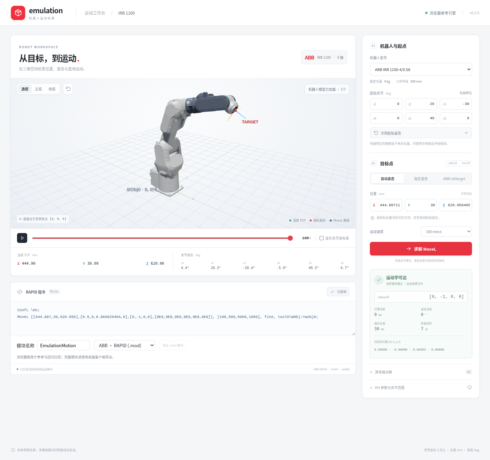

<div align="center">
  <h1>Emulation</h1>
  <p>原生机器人运动工作台 · 仿真轨迹与控制器程序</p>
</div>

桌面客户端使用 **Tauri 2 + Rust + Three.js**：系统 WebView 与 GPU 负责界面和三维显示，Rust 后台负责正逆运动学、配置判断、路径规划和程序生成。安装后无需用户安装 Node.js、Rust、Python 或启动本地服务。

在三维场景中输入目标位置或姿态，求解关节角与配置，检查从当前起点出发的直线运动，再预览姿态并导出机器人程序。当前实际支持 ABB IRB 1100 与 RAPID `.mod`；长期方向是同一仿真轨迹导出为不同品牌程序，现阶段不做厂商程序导入解析。

机器人基座固定在世界原点。项目复用现成的 IRB 1100 分段 CAD 网格，尺寸、机械零位、关节正向与运动范围按 ABB 官方资料校验。



上图为工作台的浏览器参考视图；客户端沿用此界面，并启用 Rust 原生引擎和模块导出。

## 客户端

安装包由 [桌面构建工作流](https://github.com/ecojust/emulation/actions/workflows/desktop.yml)生成：成功运行中的 Artifacts 提供 macOS Apple Silicon／Intel 的 DMG 和 Windows x64 的安装程序，附源提交、CPU 架构和 SHA-256 清单。这里是 CI 构建产物，不等同于已发布 GitHub Release。

- macOS 13+：分别选择 ARM64 或 x64 安装包。当前使用 ad-hoc 完整性签名，未做 Apple Developer ID 公证，首次打开可能需要系统的安全确认。
- Windows x64：安装程序会检查系统 WebView2 运行时；缺少时由内置引导程序安装，可能需要联网。
- 机器人网格随客户端打包，运动求解与程序生成均在本机执行。

开发客户端需要 Node.js **22.12+**（推荐24）、Rust stable，以及 macOS Xcode Command Line Tools 或 Windows Visual Studio C++ Build Tools。

```sh
npm ci
npm run desktop:dev
```

在对应系统上生成安装包：

```sh
npm run desktop:build
```

桌面求解只调用 Rust；IPC 失败时显示错误，不静默切回 JavaScript。后台只有一个计算线程和一个待处理请求槽，编辑参数会取消过期任务。

## 浏览器参考模式

需要 Node.js **22.12+**（推荐 Node.js 24）及支持 WebGL2 的现代浏览器；macOS 和 Windows 使用相同工程。

```sh
npm ci
npm run dev
```

打开终端输出的本地网址，默认 `http://localhost:5173`。浏览器模式保留 TypeScript 参考求解器，供演示和迁移对照；界面明确标识，不能用它代表 Rust 客户端的性能。完整程序模块在桌面版导出。

生产构建与本地查看：

```sh
npm run build
npm run preview
```

`dist/` 可以部署到静态 HTTP 服务；由于使用模块和 Web Worker，应通过 HTTP 打开，不直接双击 HTML 文件。

## 使用流程

1. 选择 IRB 1100-4/0.58 或 IRB 1100-4/0.475，观察基座原点及机械零位。两种型号均使用自己的现成网格和尺寸。
2. 设定起始关节角，或选择界面的示例起始姿态。官方机械零位与应用示例分开：全零位的轴5为0°，处于腕部奇异点，不能被当成已验证的直线起点。
3. 输入毫米单位的 XYZ；可让系统选择姿态，也可输入固定姿态或完整 ABB `robtarget`。ABB 四元数使用 `[w,x,y,z]` 顺序；欧拉角遵循 `OrientZYX(Rz,Ry,Rx)`。
4. 求解后查看关节角、`[cf1,cf4,cf6,cfx]`、位置／姿态误差和路径结果。其他终点逆解只作参考，不能代替整段路径验证。
5. 播放直线姿态预览，复制生成的 `MoveL`。修改目标、起点或型号后，原来的指令会失效，需要重新求解。
6. 在客户端输入模块名称，点击“导出 .mod 模块”。原生核心重新验证输入和路径，生成完整 `MODULE`／`PROC main`。模块会用 `CJointT()` 检查实际六轴与仿真起点是否一致；不匹配时返回，不自动插入到起点的移动。

## 多品牌程序与性能

模型及运动求解、品牌中立轨迹数据、控制器后处理器分别实现。后处理输出 `ProgramBundle`，能表示 KUKA 等控制器需要的多文件程序。

| 品牌 | 目标格式 | 当前状态 |
| --- | --- | --- |
| ABB | RAPID `.mod` | 两款 IRB1100、单段已验证 MoveL 模块生成 |
| FANUC 发那科 | `.ls` | 接口已预留，型号／配置／控制器适配未实现 |
| KUKA 库卡 | `.src` + `.dat` | 接口已预留，型号／S/T／KSS 适配未实现 |
| YASKAWA 安川 | INFORM `.jbi` | 接口已预留，型号／坐标／控制器适配未实现 |

未实现的品牌明确拒绝导出，不通过替换 ABB 指令名称伪造兼容。后续品牌接入需增加对应模型、配置规则、后处理及独立验证，详见[程序格式与扩展](docs/program-formats.md)。

同机 release 基准中，当前 Rust 逆解中位约78 µs（旧 TS 约245 µs），35 mm MoveL 约276 µs（旧 TS 约2.1 ms），自动方向搜索代表路径约21.5 ms（旧 TS 约238 ms）。改善包含原生编译和分配／搜索优化，不是只比较语言；这些是内核耗时，不含桌面 IPC、GPU 渲染或实际机器人周期。完整环境、原始批次和可复现命令见[性能记录](docs/performance.md)。

## 模型与运动学

- 官方几何来源：ABB 产品规格 **3HAC064993-001**；标准 DH 按其标称几何和关节约定推导。完整参数、零位及官方工作空间核对见 [机器人参数](docs/robot-model.md)。
- 现成外观来源：[Workr Robot Asset Library](https://github.com/work-r-labs/robots)，MIT 许可。两种型号分别包含基座和六个关节部件；原始字节、固定版本与校验值见 [模型资源说明](docs/model-assets.md)。这些是社区分发的现成资产，并非 ABB 官方认证的仿真包。
- RAPID／配置依据：ABB 技术参考 **3HAC050917-001**，包括 `confdata`、四元数、`robtarget`、`ConfL` 与 `MoveL`。详见 [RAPID 与配置约定](docs/rapid.md)。
- 场景使用右手坐标系，世界 Z 轴向上；基座在 `[0,0,0]`。公开位置单位为 mm、关节角为度。使用 `tool0` 的法兰中心和 `wobj0`，没有隐含工具偏移或工件坐标变换。
- 正运动学、逆运动学和显示姿态使用同一条 DH 链。现成网格从各自的共同机械零位坐标变换到实时关节姿态。
- 解析逆解适用于这里的两款 IRB 1100；自动姿态先尝试保持起始方向，再搜索有限组方向，结果不宣称全局最优，也不是任意 DH 表的通用求解器。
- MoveL 按不超过 5 mm／2° 的间隔采样，检查 cfx 不变、关节限位及连续性。相邻采样任一轴变化超过 15° 时保守拒绝；接近奇异点的部分路径可能需要调整起点或方向。

可达结果是基于标称几何、关节范围和离散路径检查的**运动学仿真**。它不包含环境／自碰撞、负载、制动、个体校准或完整控制器动态验证；播放用时也不代表真实控制器节拍。生成的 RAPID 需在对应 RobotStudio／控制器配置中复核，不能将这里的预览当作实机执行证明。

## 开发与检查

```sh
cargo test --workspace --no-default-features --locked
cargo build -p emulation-core --bin core-cli --locked
npm run check
npm test
npm run build
```

`npm test` 包含调用真实 Rust 可执行文件的对照测试，需要先执行上面的 `cargo build`。纯核心和后台任务测试无需安装 GTK／WebKit；桌面窗口及安装包在各原生系统验证。

实际浏览器回归使用 Playwright：

```sh
npx playwright install chromium
npm run test:ui
```

已有 Chromium 时可设置 `EMULATION_CHROMIUM` 指向其可执行文件，避免重复下载。此回归检查浏览器参考模式；桌面工作流另外对实际安装的应用运行 `--smoke-test` 与 `--ui-smoke-test`，检查原生算法、真实 WebView→IPC→Rust、WebGL2 和打包模型。

| 目录 | 内容 |
| --- | --- |
| `crates/robot-core/` | 独立 Rust 模型、正逆解、配置、路径规划、程序 IR 与品牌后处理 |
| `src-tauri/` | 原生窗口、后台任务／取消、IPC、模块保存与安装配置 |
| `src/robot/` | 原生调用、渲染所需 FK，以及浏览器 TypeScript 参考算法 |
| `src/scene/` | Three.js 场景、现成机器人模型、姿态与轨迹显示 |
| `public/models/` | 两款 IRB 1100 的原始分段 STL |
| `vendor/work-r-labs/` | 上游许可、固定来源和逐文件摘要 |
| `tests/` | 数值与浏览器回归 |
| `history/` | 用户原话、验证与交接记录 |
| `scripts/` | 同机性能对照、安装包验证与交付清单 |

项目采用 [MIT 许可证](LICENSE)。生产构建包含应用许可证、前端依赖声明及模型来源许可。接手开发先读 [AGENTS.md](AGENTS.md) 和 [历史索引](history/INDEX.md)。
