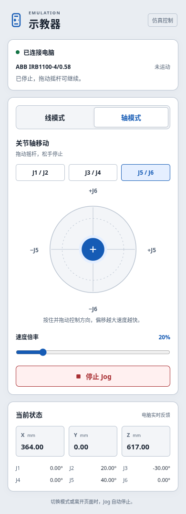
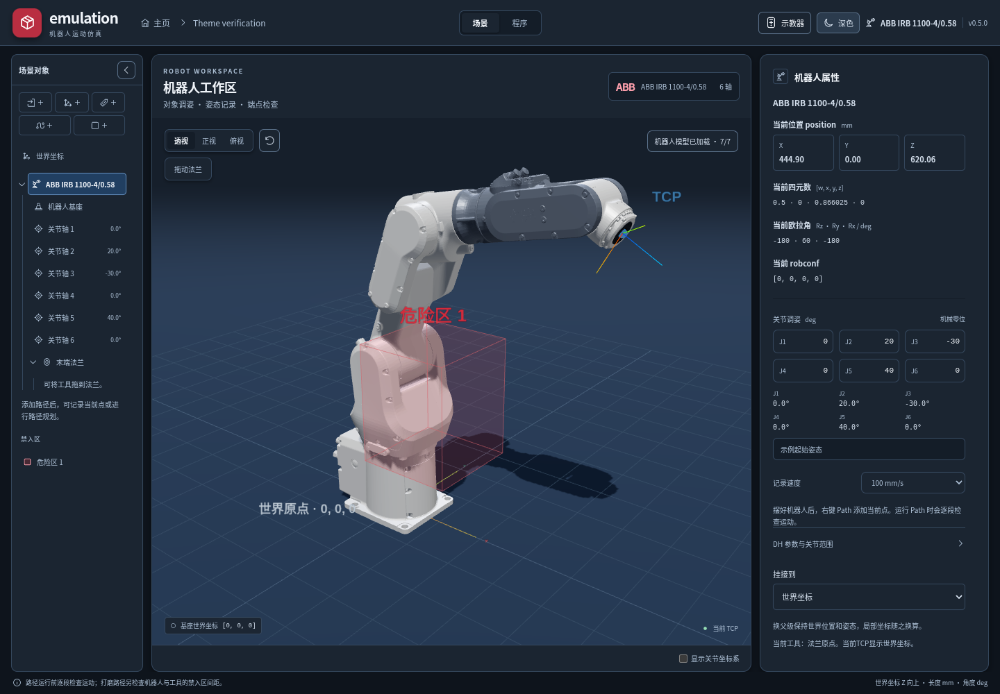

# 手机示教器

在桌面客户端打开项目，点击顶部“示教器”。手机与电脑连接同一可互通的局域网后，用相机扫描二维码，在浏览器中打开示教器；手机不需要安装App。电脑有多个网络接口时，可在弹窗中选择手机可访问的地址。macOS首次使用可能询问局域网权限；如果网页无法打开，检查同一网络和系统防火墙中的Emulation连接许可。

关闭二维码弹窗不会断开手机。“断开示教器”、返回项目主页或关闭应用会结束会话。二维码在10分钟内可用于配对，重新生成会撤销旧凭据；同一时刻仅接受一个手机控制端。已经建立的连接最长保持8小时。配对链接不保存到项目或日志。

## 操作

- **线模式**：按XY、XZ或YZ选择摇杆的两个方向，移动当前TCP。世界坐标沿场景轴移动，工具坐标沿当前工具轴移动；保持工具朝向不变。
- **轴模式**：选择J1／J2、J3／J4或J5／J6，直接调整对应关节。机械零位也可以使用轴模式。
- 摇杆离中心越远，速度越快；速度滑块设置倍率。直线速度上限100 mm/s，关节上限30°/s且不超过型号自身限速。默认倍率20%。
- 松手、停止按钮、取消触摸、手机失焦／旋转／切到后台或连接中断都会结束当前手势。恢复后需重新按住；不会补跑积压的移动。
- 电脑显示当前实际接受的姿态，手机同步显示TCP、关节和状态。手机连接期间，场景对象及属性编辑暂时锁定；仍可查看三维场景或断开连接后继续编辑。切换程序视图会暂停手机示教。

当固定方向的直线段不可达、遇到奇异位置、关节限位或禁入区时，保留上一个有效姿态并显示原因。可以松开摇杆后改变方向，或使用轴模式先调整姿态。现有验证覆盖机器人／工具的保守扫掠包络与禁入区，不认证导入工件碰撞、自碰撞或实际控制器执行。本模块仅控制仿真，不连接真实机器人。

## 模块边界

| 模块 | 职责 |
| --- | --- |
| `src/pendant/mobile/` | 独立HTML／CSS／JavaScript手机页面、SVG摇杆、触摸与失联停止；不携带运动求解器 |
| `src-tauri/src/pendant/` | 按需启动的Rust HTTP／WebSocket服务、配对及单控制端、输入与桌面心跳期限、固定页面资源 |
| `src/pendant/types.ts`、`transport.ts` | 会话、状态与输入协议及本机Tauri桥接 |
| `src/pendant/usePendant.ts` | 当前项目的连接生命周期、电脑状态发布、修改／切换／关闭时取消旧控制 |
| `src/pendant/motion.ts` | 一次只允许一个在途增量，拒绝过时结果；验证原生结果与FK及指定增量一致 |
| `crates/robot-core/src/pendant_jog.rs` | 各品牌六轴链的直线／关节增量计算，基座与工具变换、限位及禁入区扫掠检查 |

桌面增量计算只调用Rust，并复用有界Engine任务槽；通信或原生求解失败时不退回JavaScript。当前协议使用本地IPv4 HTTP／WebSocket，不依赖云服务或互联网中转。协议字段、资源边界及认证流程见[原生连接模块](../src-tauri/src/pendant/README.md)。后续可扩展手机功能和消息种类，无需把手机界面并入桌面工作区。

## 主题

主页及项目顶部的主题按钮在明／暗主题间切换并保存选择。普通文本、状态、输入框、代码高亮与三维背景使用统一语义颜色；切换只更新外观，不重建机器人、相机或项目数据。手机页面根据手机系统的明暗设置显示。

## 验证与第三方

- 原生测试覆盖六款型号、固定朝向／工具坐标、直接关节增量、限位、取消和薄障碍的扫掠检查。
- 手机浏览器测试覆盖真实指针与触摸取消、横竖屏、断联及重新操作；`pendant-check`联调使用实际Rust套接字和嵌入页面。
- 安装后的`--ui-smoke-test`通过实际扫码入口启动服务，使用真实WebSocket发送有限手势并检查ABB／GP7界面中的机器人运动与停止。
- 桌面二维码使用MIT许可的[qrcode 1.5.4](https://github.com/soldair/node-qrcode)及其浏览器运行依赖dijkstrajs，许可证随前端`THIRD_PARTY_NOTICES.txt`分发；原生依赖来源见连接模块文档。手机页面无外部脚本、字体或CDN依赖。
