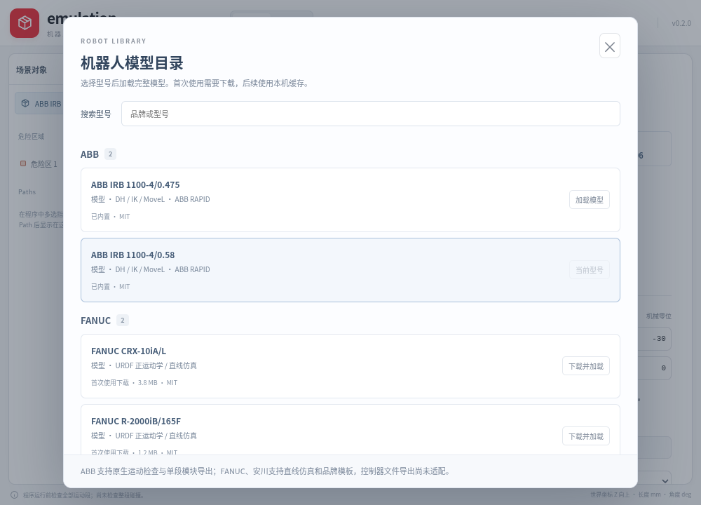
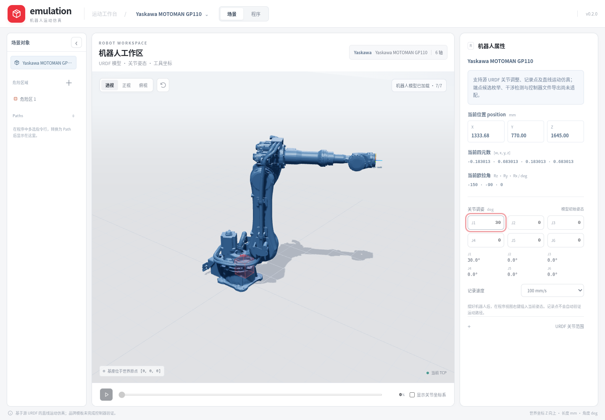

# 机器人型号目录

点击顶部当前型号打开目录，按 ABB、FANUC、KUKA、Yaskawa 分组。选择已内置型号直接加载；新型号首次下载，展示进度并允许取消、失败重试。全部文件校验和网格解析成功后才替换当前机器人；取消或失败保留原场景与原规划结果。

| 型号 | 资源方式 | 当前能力 |
| --- | --- | --- |
| ABB IRB 1100-4/0.475 | 已内置 | 标称DH、IK／多配置、MoveL、TCP Jog、端点实际网格检测、Path／循环仿真、RAPID模板与源码保存 |
| ABB IRB 1100-4/0.58 | 已内置 | 同上，使用自己的尺寸与网格 |
| FANUC CRX-10iA/L | 首次下载 | URDF运动学、数值MoveL／TCP Jog、多个端点候选与预览、实际网格检测、Path／循环仿真、LS模板与源码保存 |
| FANUC R-2000iB/165F | 首次下载 | 同上，显示源模型的两个附加配重部件 |
| Yaskawa MOTOMAN GP7 | 首次下载 | URDF运动学、数值MoveL／TCP Jog、多个端点候选与预览、实际网格检测、Path／循环仿真、INFORM模板与源码保存 |
| Yaskawa MOTOMAN GP110 | 首次下载 | 同上 |
| KUKA | 当前来源没有资源 | 不提供虚构的可加载型号 |

模型库来自 [work-r-labs/robots](https://github.com/work-r-labs/robots)，固定版本为 `ab6aa489855256de07ba46c7b45887fdbc42b607`。该版本实际包含 ABB、FANUC、Kawasaki、Yaskawa，未包含 KUKA。目录按实际审查过的资源建立，不能从仓库 README 的品牌数量推断型号可用。IRB1010发现归一化URDF与网格轴向不一致，暂未加入。

新增型号没有套用IRB1100求解器。场景左侧显示机器人、区域、Path与点对象；选择机器人后，右侧显示对应工具坐标、姿态、关节角和范围，ABB另有标称DH表。先创建Path，再向它添加当前点；每个点唯一归属一个Path。程序视图左侧切换为当前型号的模块文件列表，中央直接编辑源码。六个型号在同一项目中分别保留本体状态、参考坐标系、工具、Path与点，以及各自的源码模块；切换时清除旧运动结果、对象选择和菜单，不把其他型号的点或参数带入当前机器人。

四款FANUC／Yaskawa使用各自URDF六轴运动链，支持TCP平移／旋转拖拽、position模式的XYZ目标、target模式的位置与姿态、端点候选预览，以及候选姿态对禁入区的实际网格检查。预览只改变临时本体显示；只有显式点击“用当前姿态更新点”才把候选关节保存到该点，其目标位姿和速度保持不变。机器人基座、参考坐标系、工具与Path的挂接使用同一坐标图；换父级保持世界位置与姿态。Path可记录当前点、全段预规划播放、循环及停止，也可转换为独立LS／INFORM源码模块。

这些功能没有补齐厂商控制器配置映射或整程序控制器后处理。数值候选不套用ABB robconf；FANUC／Yaskawa模板与源码保存不代表控制器可直接执行，Yaskawa的TOOL／RCONF保留待配置占位，未伪造脉冲比例。

Path右键“运行”与属性中的“运行 Path”仅检查该Path：先检查当前姿态到首点，再检查各点间全部段；循环另检查末点到首点，之后不重复最初的接近段。任一段失败则不开始播放，停止保留当时显示的姿态。转换生成的模块与Path独立，修改源码不驱动仿真，修改或删除Path也不会覆盖或删除模块。左树Path点的“移动至此”仅作关节插值定位，不代表直线运动或碰撞验证。工作流和模板边界分别见[工作区说明](workspace-architecture.md)与[程序模板](program-templates.md)。





## 坐标与显示

URDF的 `xyz` 为米、`rpy` 为弧度，固定轴旋转顺序为 `Rz(yaw) Ry(pitch) Rx(roll)`。可动轴在各自关节坐标系中旋转，树按父子关系遍历，保留固定关节和侧分支。实际网格变换为：

```
世界到 link 的变换 × visual origin × mesh scale
```

FANUC采用毫米网格配合URDF的缩放与视觉原点，Yaskawa采用link局部米制网格。不能统一乘0.001，也不能使用IRB1100共同零位网格的补偿方法。机器人基座默认在世界原点，可挂接到参考坐标系；世界Z向上，网格和运动学链都应用同一基座世界变换；界面工具坐标转换为mm，关节角显示为度。源URDF是模型预览资料，不是厂商控制器的个体标定参数。R2000的balancer按源URDF固定分支显示，未实现真实平衡连杆约束或动力学。

加载器只接受目录内的STL引用及fixed／revolute／continuous关节；拒绝DTD、外部资源、路径穿越、mimic、无效数值、循环与断开的树。完整网格准备成功后再交付给场景，切换时释放旧GPU资源，并按新模型的实际尺寸调整相机。

通用规划仅接入当前四款具有六个受限旋转关节的型号。从根到法兰提取固定变换、局部关节轴和速度／角度限制，不把配重显示分支误当作工具运动链。桌面由Rust执行阻尼最小二乘逆解；浏览器使用参考实现，原生失败不会自动退回浏览器算法。

| 数值边界 | 当前行为 |
| --- | --- |
| 运动链 | 六个不重复的旋转关节，最多32个固定／可动步骤；使用各型号URDF限位与速度 |
| 单次局部逆解 | 最多80次迭代，每次更新最多4°，线搜索最多8次；位置容差0.001 mm，姿态容差0.00001 rad |
| 多端点候选 | 最多64个确定性种子，返回最多32个去重候选；按距当前关节的距离排序，保留不同整圈关节值；不保证穷举，未找到候选不等于证明全局不可达 |
| 单段TCP运动 | 平移采样不超过5 mm、旋转不超过2°，最多1601个采样；相邻关节变化不超过15°，速度范围1–2000 mm/s并同时约束关节速度 |
| position模式 | 先保持当前工具方向；失败后尝试一次有界的方向放松，并重新规划整条连续直线，不直接跳到另一端点解 |

Jog的目标和返回样本都是世界TCP位姿；每个样本转换到机器人基座，并把法兰到TCP的工具偏置纳入FK和雅可比。旋转偏置工具时保持的是TCP位置，法兰可沿相应曲线移动。按记录关节执行Path的接口仍要求连续到达记录的分支。失败或取消不返回部分可播放轨迹，输入或坐标关系变化后旧结果不可应用。端点候选本身不证明MoveL路径可达。

候选端点网格检测覆盖这些型号的全部visual部件，包含R-2000的两个配重分支；开放网格保留“无法确定”状态，详见[网格验证说明](mesh-collision-validation.md)。离散运动学和端点网格检查没有覆盖控制器奇异区、完整路径网格碰撞、自碰撞、动力学或个体校准；打磨规划的连续包络检查另行执行，不能用端点通过替代。

## 项目与对象删除

启动后在项目主页新建、打开、重命名或删除本地项目。项目保存当前型号及各型号的本体／关节、坐标层级、工具、Path、禁入区、源码模块和视图；返回主页时先保存模块草稿，再从实际3D场景生成封面并保存场景，失败则保留编辑器供重试。桌面正常关闭前也保存场景与模块草稿，封面沿用最近一次返回主页的截图。项目库使用当前应用的本地IndexedDB，与模型下载缓存分开，不是跨设备同步或可携带的项目文件。

对象树的机器人、参考坐标系、工具、禁入区、Path和点可以右键删除，并先显示影响说明。关节轴和法兰属于本体，不能单独删除。删除机器人时，已挂接工具转到世界坐标并保持世界位姿，其余独立对象和已生成模块保留；删除参考坐标系时，其直接子对象同样转到世界坐标。删除当前工具后TCP恢复为法兰；删除Path同时删除其点，删除点保留Path容器。主页删除项目会移除项目内的场景和模块草稿，已经另存到磁盘的程序文件不受影响。

## 下载与缓存

[src/catalog/catalog.json](../src/catalog/catalog.json)保存型号、固定URL、逐文件字节数、Git blob SHA-1和SHA-256。应用不接受用户传入的任意下载URL或文件路径。

桌面由Rust下载到应用数据目录下的模型缓存。暂存文件在完全校验后原子提交；取消和错误清理当前暂存，完整旧缓存保留。再次使用会重新验证文件，完整缓存不需要网络。加载只向受限Tauri资源协议开放已验证的具体文件。

浏览器参考模式以相同目录校验文件，使用IndexedDB按型号和来源版本缓存；它与桌面缓存互不共享。清除浏览器站点数据会删除浏览器缓存。缓存损坏时重新下载；网络或存储失败会显示错误，不切换成残缺模型。

目录生成脚本会下载审查过的资源到临时目录，再核对原始Git对象、STL顶点与来源记录：

```sh
node scripts/generate-model-catalog.mjs --check
```

已有来源缓存时可加 `--offline`。四款新增机器人的STL不加入应用安装包，避免所有用户预先下载全部资源。

## 许可来源

Workr集合仓库的MIT声明不替代原始模型声明。ABB／FANUC保留Toshinori Kitamura的MIT原文；Yaskawa的来源包声明BSD-3-Clause，保留原文package.xml、逐网格来源映射和标准BSD条款模板，并明确上游未提供独立版权文件，不猜写版权持有人。详见[原始模型声明](../vendor/work-r-labs/model-notices/README.md)。
