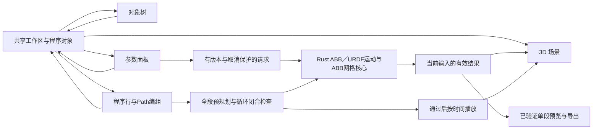

# 工作区与视图协作

## 当前分区

工作区占满窗口，页面本身不滚动。左侧对象树、右侧属性、程序行、源码与问题面板各自管理溢出，中央3D区域使用剩余空间。原生窗口的最小尺寸为1000×720。

| 区域 | 职责 | 切换视图后的行为 |
| --- | --- | --- |
| 顶部工具栏 | 型号目录入口、场景／程序视图与版本 | 始终可见；已移除引擎标识 |
| 左侧场景对象 | 机器人、危险区、可展开的Path与目标点 | 只显示对象树，共用选择；整栏可收起 |
| 中央场景 | 模型、ABB法兰Jog、危险区拖柄、Path点线、运动播放与停止 | 保留挂载、相机和资源，隐藏时不可交互 |
| 中央程序 | 示教点／Path与运行控制；品牌源码、多文件、高亮／补全／说明／诊断 | 示教快照共享；源码工程按型号独立保存，两者显式生成 |
| 右侧属性 | 机器人状态／DH或URDF关节、品牌点位表示、Path或区域属性；ABB点另有候选解和网格检测 | 由选中对象决定，独立滚动 |
| 底部状态 | 仿真范围和单位约定 | 始终可见 |

当前姿态表示当前显示的机器人关节与TCP，来自关节调整、播放采样、Jog接受的姿态或显式应用的逆解；读数与3D模型使用同一组关节。程序点是记录时的快照，继续移动机器人不会修改已有记录。选择点只选择属性与标记，更新点或采用其他逆解由显式操作完成。

## 状态所有权

`src/workspace/useWorkspace.ts`管理活动视图、左栏折叠、危险区草稿和`robot | zone | path | target`选择。`program.ts`与`useProgram.ts`管理六个目录型号各自的有序直线指令快照、Path引用及revision；`ProgramPanel.tsx`负责右键菜单、多选、示教／代码模式和运行控件。`program-templates.ts`按目录固定品牌映射点表示，`program-runner.ts`规划完整运行序列并按时间取样。`App.tsx`持有当前机器人、异步检查、单段结果和动画时钟，把同一份对象数据传给树、属性和场景。

`src/programming/useDocuments.ts`及`storage.ts`管理每型号多文件、原文／保存基线与本地草稿；`RobotCodeEditor.tsx`管理CodeMirror状态和原文换行到显示位置的映射。`useSourceAnalysis.ts`按型号／语言版本／sourceRevision调度独立Worker，元数据保存不会触发重复分析；旧结果、取消及线程失败不会冒充当前检查通过。切换代码模式停止当前示教播放，源码没有解释器时禁用独立运行入口，不能借用旧程序点运行。

程序点带稳定ID、P编号、位置、四元数、六轴关节角和速度，捕获时复制并冻结嵌套数组。仅ABB点保存robconf；FANUC／Yaskawa的该字段为null，不套用ABB配置。界面分别显示RAPID／LS／INFORM及MoveL／L／MOVL。Path保存按原程序顺序排列的点ID。非连续选择转Path只改变归属，不移动程序行；重新归组和删除会维护引用、清除空Path。插入后的新对象选择和数据更新在同一React批次生效，过期ID在渲染时剔除。切换型号保留各自会话程序，清除当前行选择、过期菜单和旧运动结果。

型号目录使用单独的加载事务：`src/catalog/client.ts`取得并验证资产，URDF解析及全部网格准备成功后才将`LoadedCatalogModel`交给App；失败或取消不提交选择。App区分已验证的ABB运动模型和通用URDF模型，成功切换会取消旧请求并清空旧规划，所有视图随后读取同一型号和关节状态。App持有已准备资产的释放权，场景持有自己的GPU几何副本。模型缓存是磁盘／IndexedDB中的资源，不等同于已保存项目。

- 区域使用稳定ID；名称只用于显示。删除、选择、命名或切换视图不会把另一区域的检测结果套到当前对象。
- 原始输入草稿保留字符串，空值或临时无效数值明确提示，机器人保留最后有效姿态。任何区域配置无效时显示未完成，不能沿用旧的无干涉结论。
- 点／本体／型号改变使旧单段规划失效。拖动中切换对象／视图会释放鼠标捕获和Orbit锁，保留最后接受的位置。
- ABB端点检查独立调用Rust逆解，只返回该姿态的可用配置，不构造“自身到自身”的MoveL。采用解会更新该点的关节与robconf并改变本体，点revision使旧路径与检查失效。通用URDF点没有多解枚举或网格检测入口。
- 点面板的直线运动检查以操作当时的本体为起点、该点为终点。ABB配置必须匹配；URDF数值规划必须连续到达记录的关节分支。通过后可预览该单段，控制器导出仍仅支持ABB独立单段。Path虚线只是记录点的连接，编组本身不代表已完成运动检查。
- 干涉请求包含完整区域集合与候选关节，结果带候选ID、区域ID和部件索引。输入指纹、AbortSignal及原生请求ID共同隔离迟到结果。
- 原生后台一个CPU线程，前台运动／导出、端点检查和干涉检查各有一个等待槽，优先级依次降低。背景检查不取消前台；前台可取消背景计算，避免拖动等待冷索引或过时逆解。

## 完整程序运行、循环和定位

“运行程序”读取当前型号的全部程序行，先检查当前本体到首点，再依次检查点间直线段；不会只运行当前选中的Path或多选行。所有段通过才开始播放，某一段失败则显示指令位置并保留运行前姿态，不播放部分成功结果。单次最多256条指令、总计200000个轨迹采样；运行使用点记录的速度和关节速度约束，不代表控制器动态仿真。

开启循环后，还须先检查末点到首点的闭合段。第一次播放包含当前姿态到首点的接近段；后续循环由闭合段与首点之后的程序段组成，不重新跳回或重放最初的接近姿态。界面显示执行行和循环次数。播放由统一时间轴采样驱动六轴姿态，程序行高亮与场景读数跟随同一结果。

运行、规划或定位时锁定程序修改、型号切换和姿态编辑；场景与程序页都有停止入口。停止会取消当前请求及后续动画帧，保留最后显示的机器人姿态，不跳到目标或机械零位。停止后再次运行从当时姿态重新规划。

左树展开Path后，点的右键菜单“移动至此”提供独立的仿真定位：按关节角平滑插值到记录姿态，支持停止，但不把该过程当作直线规划、碰撞检查或控制器运动指令。普通选择点仍只查看属性，不自动移动本体。

通用URDF型号的运动链直接来自当前已校验URDF中的六个旋转关节、固定变换和工具链，桌面调用Rust数值逆解及TCP直线采样，浏览器保留相同边界的参考实现。没有借用IRB1100的DH或robconf规则。详见[型号目录](robot-catalog.md)、[原生规划器](native-planner.md)和[品牌模板](program-templates.md)。

## 后续仿真与编辑的接入点

以下为后续规划，不是当前已实现能力：

1. 将App中的机器人／运动状态进一步整理为项目文档，和视图状态分开。项目文档需要显式schema版本、机器人型号、坐标系、单位、场景对象、运动序列和控制器目标；相机、面板展开状态属于工作区偏好。
2. 当前已有完整程序的运动学预规划和时间采样播放；后续可增加时间轴编辑与区间诊断。完整轨迹干涉仍需对每段路径检查并标记具体区间，不能由端点感叹号替代。
3. 当前程序页已有品牌源码编辑、静态语法分析、多文件导入与草稿。后续解释器须将用户源码转换为新的可执行程序版本，并显式拒绝未实现的语义；整程序控制器后处理仍待实现，保留ABB单段原生验证入口。详情见[离线编程](offline-programming.md)。
4. 添加品牌时通过模型、配置规则和后处理适配器接入。FANUC／Yaskawa当前已有URDF六轴直线仿真，但没有TCP Jog、多解枚举、网格检测或控制器导出；品牌模板不能替代控制器后处理。
5. 项目保存／恢复将序列化项目状态，不序列化Three对象、IPC句柄或Worker；恢复后重新验证数值与型号。当前程序快照与对象仅在本次会话内共享，尚无项目文件保存。

## 干涉结果的含义

当前干涉实现仅适用于两款IRB1100；通用URDF型号只显示区域，不输出干涉结论。最多64个区域、256个候选姿态。区域是世界轴对齐方块，机器人原始STL按`F_i(q) * inverse(F_i(0))`放置。OBB／区域15轴SAT只负责快速排除；重叠后，将区域逆变换到部件坐标，通过缓存BVH筛选三角面并执行三角面／方块检测。接触也计入干涉，接触容差为0.000001 mm。

无表面接触时，对闭合且边方向一致的整个网格检查内部奇偶关系，保留原始模型的内腔。边界／非流形／退化面或射线退化导致不能确定时返回`uncertainLinks`；每个区域与总体都分别保留确认命中和未确定连杆，界面优先显示确认干涉，并在提示中列出未确定项。解析失败、取消、超时及过时结果均不能变成无干涉。

桌面使用Rust原生网格索引，按型号／连杆惰性缓存；前台运动可以取消后台索引构建／检查，后台不得取消前台。浏览器使用独立Worker及`three-mesh-bvh` 0.9.18（[源码](https://github.com/gkjohnson/three-mesh-bvh/tree/v0.9.18)，[随包MIT许可](../public/licenses/three-mesh-bvh.txt)），成功的Worker保留一个以复用网格索引，取消或错误时终止并重建。原生失败没有JS回退。

这是候选端点检查，未验证自碰撞、整段路径、网格全局自交或物理控制器安全区域。原始STL保持不变，包围盒资料由`node scripts/generate-collision-bounds.mjs --check`核对14件固定来源STL与摘要；拓扑与实际网格案例见[验证说明](mesh-collision-validation.md)。

## 公开界面参考

核对日期：2026-11-09。只借鉴信息组织和工作流，未复制厂商界面图片、图标或软件代码到本项目。

- [ABB RobotStudio Suite](https://www.abb.com/global/en/areas/robotics/products/software/robotstudio-suite)：官方对完整3D离线编程、仿真和路径工作的定位，用于明确场景／程序共享项目的方向。本项目未实现其虚拟控制器能力。
- [KUKA iiQWorks.Sim](https://www.kuka.com/en-de/products/robot-systems/software/planning-project-engineering-service-safety/iiqworks-sim-robot-simulation-software)：原KUKA.Sim链接当前重定向到此。已查看官方产品界面图，参考顶部命令、左侧树、中央3D、右侧属性及底部分析区的分工。
- [RoboDK Interface](https://robodk.com/doc/en/Interface.html)及[Basic Guide](https://robodk.com/doc/en/Basic-Guide.html)：公开说明菜单、工具栏、状态栏和Station Tree中机器人／坐标系／工具／程序对象，参考其对象选择组织方式。
- [遨博AuboStudio v0.29界面说明](https://docs.aubo-robotics.cn/user_manual/zh/v0.29/aubostudio/02-introduction/01-interface.html)：公开中文手册区分功能菜单、全局状态栏及随功能变化的操作视图，参考固定框架与功能视图的边界。当前项目为离线工作台，没有示教器或实机操作入口。

这些是已核对的公开资料；没有据此宣称已复现四大家族全部软件，也没有将未能访问的厂商页面当作已审阅依据。
