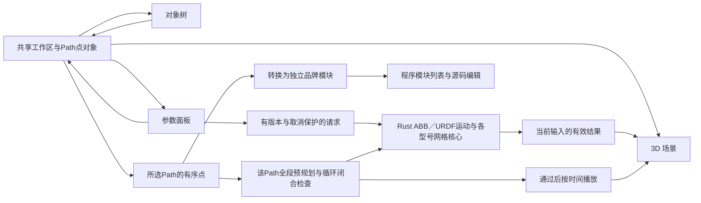

# 工作区与视图协作

## 当前分区

工作区占满窗口，页面本身不滚动。左侧对象树或模块列表、右侧属性、源码与问题面板各自管理溢出，中央3D区域使用剩余空间。原生窗口的最小尺寸为1000×720。

| 区域 | 职责 | 切换视图后的行为 |
| --- | --- | --- |
| 顶部工具栏 | 项目主页入口、型号目录、场景／程序视图与版本 | 始终可见；已移除引擎标识 |
| 左侧列表 | 场景视图显示参考坐标系、机器人及六轴／法兰、工具、禁入区、可展开的Path与目标点；程序视图显示当前型号的全部模块文件 | 随视图切换内容，保留各自对象／模块选择；整栏可收起 |
| 中央场景 | 模型、六款机器人的TCP Jog、危险区拖柄、Path点线、运动播放与停止 | 保留挂载、相机和资源，隐藏时不可交互 |
| 中央程序 | 当前模块的品牌源码、高亮／补全／说明／诊断 | 只编辑模块文件；首次进入后保留编辑器与撤销状态 |
| 右侧属性 | 机器人状态／DH或URDF关节、品牌点位表示、Path操作和仿真控制、区域属性；各型号目标点的候选解和网格检测 | 场景视图由选中对象决定，独立滚动；程序视图隐藏 |
| 底部状态 | 仿真范围和单位约定 | 始终可见 |

场景左侧先“添加 Path”，调整机器人后右键该Path选择“添加当前点到 Path”。每个点唯一属于一个Path，按添加顺序排列；空Path可以保留并继续加点。右键Path或在其属性中“转换为程序”会创建独立模块并切到程序视图，重复转换生成新文件，已有源码不会被覆盖。删除点保留Path容器；删除Path会删除它拥有的点，已生成模块保持不变。

当前姿态来自关节调整、Path运行或点定位的动画采样、Jog接受的关节与TCP。Path点是记录时的快照，继续移动机器人不会修改已有记录。候选端点解的“预览”使用独立渲染状态，只临时改变3D本体，不写回关节草稿或程序点；场景明确提示预览中，退出恢复原姿态。预览时可显式点击“用当前姿态更新点”，将候选关节／轴配置保存到选中点，保留原点的路径局部位置、方向、速度和加工用途；保存后退出预览并恢复原机器人姿态。预览不会自动成为新增示教或运动的起点，切换对象／型号／工作区会结束预览。选择点只选择属性与标记，修改已记录点仍需“用当前姿态更新点”。

界面自绘图标统一使用SVG，包括工具栏、对象树、右键菜单、告警和源码编辑器的折叠／补全图标；文字标签、程序源码与三维几何保持各自含义。

## 项目保存与对象删除

应用先进入项目主页，支持新建、打开、重命名和删除项目。每个项目在本地IndexedDB中保存有schema版本的场景、按型号隔离的本体状态／关节／参考坐标系／工具／Path与点、共享禁入区、源码模块、相机与视图。项目之间不共享可变编辑状态；模型下载缓存独立复用。未缓存型号在打开项目时先下载并验证，失败时可返回主页，不以其他机器人代替已保存型号。

返回主页前停止运动和临时预览，保存所有模块草稿，再渲染当前真实场景生成封面；即使从程序页返回，也先恢复3D渲染并保存原来的视图选择。场景或封面保存失败时保留编辑器与当前数据，允许重试。正常桌面关闭前保存模块草稿与场景，保留最近生成的封面；强制终止进程和浏览器直接关页不保证保存尚未写入的场景修改。当前是应用本地项目库，尚无可携带项目文件导入／导出或跨设备同步；清除应用站点存储会删除项目数据。

对象树的机器人、参考坐标系、工具、禁入区、Path与目标点支持右键删除，确认框说明影响。删除机器人会一并删除其关节轴和法兰显示，挂接工具以当前真实FK法兰为依据转到世界坐标并保持世界位姿，独立坐标系、Path、禁入区与模块保留；关节轴和法兰不能单独删除。删除参考坐标系把直接子对象转到世界坐标并保持位姿；删除当前工具解除TCP偏置；删除Path同时移除其点，删除点保留Path。删除操作取消旧检查和预览，已生成模块不随场景删除。主页删除整个项目则同时移除该项目的场景及模块草稿，不删除另存到磁盘的源码文件。

## 状态所有权

`src/projects/ProjectApp.tsx`持有项目主页与活动项目，`repository.ts`以事务保存项目和摘要，场景与源码更新读取最新持久行后合并，避免互相覆盖。`schema.ts`负责保存和恢复边界的数值、型号及层级验证；恢复不序列化Three对象、Worker或IPC句柄。旧版本源码草稿可一次性迁入独立项目，原草稿保留。

`src/workspace/useWorkspace.ts`管理活动视图、左栏折叠、危险区草稿和机器人／基座／关节轴／法兰／参考坐标系／工具／禁入区／路径／目标点选择。`program.ts`与`useProgram.ts`管理六个目录型号各自的Path、唯一归属的点快照及revision；`ProgramPanel.tsx`只承载源码工作区，`ModuleList.tsx`显示和选择当前型号的文件。`program-templates.ts`按目录固定品牌映射点表示，`path-module.ts`将指定Path生成独立模块，`program-runner.ts`规划所选Path的完整运行序列并按时间取样。`App.tsx`持有当前机器人、异步端点／网格检查、Path运行状态和动画时钟，把同一份对象数据传给树、属性和场景。

`src/programming/useDocuments.ts`及`storage.ts`管理每型号多文件、原文／保存基线与本地草稿；`RobotCodeEditor.tsx`管理CodeMirror状态和原文换行到显示位置的映射。`useSourceAnalysis.ts`按型号／语言版本／sourceRevision调度独立Worker，元数据保存不会触发重复分析；旧结果、取消及线程失败不会冒充当前检查通过。源码尚无解释器，程序页不提供源码运行入口；源码编辑或选中文件不会改变Path点，也不能借用Path轨迹冒充源码执行。

Path点带稳定ID、P编号、位置、四元数、六轴关节角和速度，捕获时复制并冻结嵌套数组。仅ABB点保存robconf；FANUC／Yaskawa的该字段为null，不套用ABB配置。界面分别显示RAPID／LS／INFORM及MoveL／L／MOVL。Path保存按捕获顺序排列的点ID，每个点的pathId必须指向唯一拥有它的Path。转换模块只读取该Path的点，保留其稳定编号与顺序。空Path不能转换或运行，删除最后一个点仍保留容器。插入后的新对象选择和数据更新在同一React批次生效，过期ID在渲染时剔除。切换型号保留当前项目内各自的Path，清除对象选择、过期菜单和旧运动结果。

型号目录使用单独的加载事务：`src/catalog/client.ts`取得并验证资产，URDF解析及全部网格准备成功后才将`LoadedCatalogModel`交给App；失败或取消不提交选择。App区分已验证的ABB运动模型和通用URDF模型，成功切换会取消旧请求并清空旧规划，所有视图随后读取同一型号和关节状态。App持有已准备资产的释放权，场景持有自己的GPU几何副本。模型缓存是磁盘／IndexedDB中的资源，不等同于已保存项目。

- 区域使用稳定ID；名称只用于显示。删除、选择、命名或切换视图不会把另一区域的检测结果套到当前对象。
- 原始输入草稿保留字符串，空值或临时无效数值明确提示，机器人保留最后有效姿态。任何区域配置无效时显示未完成，不能沿用旧的无干涉结论。
- 端点／区域检测按输入指纹隔离，点／型号变化后不复用旧结果。拖动中切换对象／视图会释放鼠标捕获和Orbit锁，保留最后接受的位置。
- ABB端点检查独立调用Rust逆解，只返回该姿态的可用配置，不构造“自身到自身”的MoveL。预览候选只改变临时本体显示，不修改已记录点的关节、robconf或revision；退出后恢复预览前姿态。显式更新点会递增修订号并重新检查端点；下一次运行Path时重新规划。通用URDF点独立执行有界多种子数值逆解，返回已找到的多个候选并支持预览与实际网格检测；不保证穷举，也不生成ABB配置。
- 点面板保留数据、显式更新及当前型号的候选解预览，不提供单段检查或独立播放器。运动检查由Path运行逐段执行：ABB配置必须匹配，URDF数值规划必须连续到达记录的关节分支。Path虚线只是记录点的连接，创建或转换模块本身不代表已完成运动检查。Rust单段规划与ABB后处理API仍独立保留，但界面没有单段复制／导出入口。
- 干涉请求包含完整区域集合与候选关节，结果带候选ID、区域ID和部件索引。输入指纹、AbortSignal及原生请求ID共同隔离迟到结果。
- 原生后台一个CPU线程，前台运动／导出、端点检查和干涉检查各有一个等待槽，优先级依次降低。背景检查不取消前台；前台可取消背景计算，避免拖动等待冷索引或过时逆解。

## Path运行、循环和定位

场景左树的Path右键菜单提供“运行”，Path属性也提供“运行 Path”。两者使用同一流程，明确按所点击Path的ID读取该Path拥有的点，不拼接其他Path，也不执行程序页的源码。先检查当前本体到首点，再按该Path内的顺序依次检查点间直线段。所有段通过才开始播放，某一段失败则显示指令位置并保留运行前姿态，不播放部分成功结果。单次最多256条指令、总计200000个轨迹采样；运行使用点记录的速度和关节速度约束，不代表控制器动态仿真。

开启循环后，还须先检查末点到首点的闭合段。第一次播放包含当前姿态到首点的接近段；后续循环由闭合段与该Path首点之后的各段组成，不重新跳回或重放最初的接近姿态。界面显示当前点及指令位置和循环次数。播放由统一时间轴采样驱动六轴姿态，Path点高亮与场景读数跟随同一结果。

运行、规划或定位时锁定Path／点／模块修改、型号切换和姿态编辑，并暂时禁用顶部“程序”视图入口，使场景中的停止按钮始终可达。仍可在场景内选择对象查看属性；场景运行状态提供停止入口。停止会取消当前请求及后续动画帧，保留最后显示的机器人姿态，不跳到目标或机械零位。停止后再次运行从当时姿态重新规划。

左树展开Path后，点的右键菜单“移动至此”提供独立的仿真定位：按关节角平滑插值到记录姿态，支持停止，但不把该过程当作直线规划、碰撞检查或控制器运动指令。普通选择点仍只查看属性，不自动移动本体。

通用URDF型号的运动链直接来自当前已校验URDF中的六个旋转关节、固定变换和工具链，桌面调用Rust数值逆解及TCP直线采样，浏览器保留相同边界的参考实现。没有借用IRB1100的DH或robconf规则。详见[型号目录](robot-catalog.md)、[原生规划器](native-planner.md)和[品牌模板](program-templates.md)。

## 后续仿真与编辑的接入点

以下为后续规划，不是当前已实现能力：

1. 在现有带schema版本的本地项目库上增加可携带文件格式、显式导入／导出和迁移策略；不能把应用内保存描述为已有跨设备交换格式。
2. 当前已有所选Path全段的运动学预规划和时间采样播放；后续可增加时间轴编辑与区间诊断。打磨规划另以机器人／工具包络检查完整轨迹与禁入区；端点感叹号不能代替该检查。自碰撞、工件表面和工艺约束仍需独立建模。
3. 当前程序页已有品牌源码编辑、静态语法分析、多文件导入与草稿。后续解释器须将用户源码转换为新的可执行程序版本，并显式拒绝未实现的语义；整程序控制器后处理仍待实现，保留ABB单段原生验证与后处理API。详情见[离线编程](offline-programming.md)。
4. 添加品牌时继续通过独立模型、配置规则和后处理适配器接入。当前FANUC／Yaskawa已有URDF数值直线、TCP Jog、多个端点候选与实际网格检测；后续控制器配置与文件生成仍需各控制器资料和验证，品牌模板不能替代后处理器。
5. 后续可增加场景的增量自动保存与崩溃恢复；目前完整场景的持久化边界是返回主页和正常桌面关闭，模块草稿另有保存流程。

## 干涉结果的含义

当前干涉实现适用于目录内两款IRB1100和四款FANUC／Yaskawa。最多64个区域、256个候选姿态；通用端点逆解列表另限制为32个候选。区域是世界轴对齐方块，ABB共同零位网格按`基座世界变换 × F_i(q) × inverse(F_i(0))`放置；通用网格按完整URDF父子链、visual原点和缩放放置，包含配重侧分支。包围范围只负责快速排除；重叠后，将区域逆变换到部件坐标，通过缓存BVH筛选三角面并执行三角面／方块检测。接触也计入干涉，接触容差为0.000001 mm。

无表面接触时，对闭合且边方向一致的整个网格检查内部奇偶关系，保留原始模型的内腔。边界／非流形／退化面或射线退化导致不能确定时返回`uncertainLinks`；每个区域与总体都分别保留确认命中和未确定连杆，界面优先显示确认干涉，并在提示中列出未确定项。解析失败、取消、超时及过时结果均不能变成无干涉。

桌面使用Rust原生网格索引；ABB按连杆惰性缓存，通用型号从已验证目录缓存读取全部visual并核对长度／SHA-256后按型号缓存；前台运动可以取消后台索引构建／检查，后台不得取消前台。浏览器使用独立Worker及`three-mesh-bvh` 0.9.18（[源码](https://github.com/gkjohnson/three-mesh-bvh/tree/v0.9.18)，[随包MIT许可](../public/licenses/three-mesh-bvh.txt)），成功的Worker保留一个以复用网格索引，取消或错误时终止并重建。原生失败没有JS回退。

这是机器人候选端点检查，未验证自碰撞、用户工具精确网格、整段路径网格扫掠、网格全局自交或物理控制器安全区域。原始STL保持不变；ABB包围盒资料由`node scripts/generate-collision-bounds.mjs --check`核对14件固定来源STL与摘要，通用运动链与visual描述由`node scripts/generate-generic-chains.mjs --check`核对。拓扑审查、实际网格案例及证据范围见[验证说明](mesh-collision-validation.md)。

## 公开界面参考

核对日期：2026-11-09。只借鉴信息组织和工作流，未复制厂商界面图片、图标或软件代码到本项目。

- [ABB RobotStudio Suite](https://www.abb.com/global/en/areas/robotics/products/software/robotstudio-suite)：官方对完整3D离线编程、仿真和路径工作的定位，用于明确场景／程序共享项目的方向。本项目未实现其虚拟控制器能力。
- [KUKA iiQWorks.Sim](https://www.kuka.com/en-de/products/robot-systems/software/planning-project-engineering-service-safety/iiqworks-sim-robot-simulation-software)：原KUKA.Sim链接当前重定向到此。已查看官方产品界面图，参考顶部命令、左侧树、中央3D、右侧属性及底部分析区的分工。
- [RoboDK Interface](https://robodk.com/doc/en/Interface.html)及[Basic Guide](https://robodk.com/doc/en/Basic-Guide.html)：公开说明菜单、工具栏、状态栏和Station Tree中机器人／坐标系／工具／程序对象，参考其对象选择组织方式。
- [遨博AuboStudio v0.29界面说明](https://docs.aubo-robotics.cn/user_manual/zh/v0.29/aubostudio/02-introduction/01-interface.html)：公开中文手册区分功能菜单、全局状态栏及随功能变化的操作视图，参考固定框架与功能视图的边界。当前项目为离线工作台，没有示教器或实机操作入口。

这些是已核对的公开资料；没有据此宣称已复现四大家族全部软件，也没有将未能访问的厂商页面当作已审阅依据。

## 坐标层级与打磨规划

`frame-graph.ts`和`useFrameGraph.ts`将参考坐标系、机器人基座、工具和路径的安装关系按型号隔离。局部位姿与世界位姿分别保存或派生，换父级通过逆变换保持世界位姿；工具安装位姿和TCP偏置分开。对象树只发出选择／挂接意图，位姿计算由共享模型负责；Three场景、记录点、运动求解和程序生成需使用同一变换链。详见[坐标、术语和检查范围](frames-and-grinding.md)。

Path右键“路径规划”打开独立的打磨规划弹窗。用户输入带位置与姿态的世界目标点，规划保持各target不变并选择连续关节／配置，生成的结果先预览再显式应用；模型、目标或环境修订使过期结果失效。该操作不能将普通Path的虚线或单点干涉状态直接当作全段检查通过。
