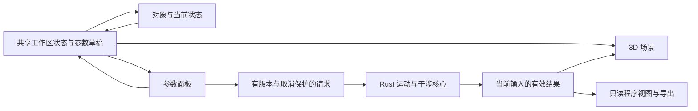

# 工作区与视图协作

## 当前分区

工作区占满窗口，页面本身不滚动。左、右功能面板和程序文本各自管理溢出，中央3D区域使用剩余空间。原生窗口的最小尺寸为1000×720。

| 区域 | 职责 | 切换视图后的行为 |
| --- | --- | --- |
| 顶部工具栏 | 场景／程序视图与引擎状态 | 始终可见 |
| 左侧对象与状态 | 机器人、危险区对象选择；可折叠position与关节读数 | 共用选择和当前姿态；整栏可收起 |
| 中央场景 | 模型、法兰Jog、危险区、轨迹／端点预览 | 保留挂载、相机和资源，隐藏时不可交互 |
| 中央程序 | 当前已验证轨迹的RAPID、复制和模块导出 | 使用同一求解结果，目前只读 |
| 右侧参数 | 机器人、起点、position／target、候选解、区域编辑 | 选择左侧区域时编辑同一对象；独立滚动 |
| 底部状态 | 仿真范围和单位约定 | 始终可见 |

当前姿态表示当前显示的机器人关节与TCP。它可能来自起点、播放采样、Jog接受的姿态，或“应用”的端点预览；数据源由App统一选择，读数与3D模型使用同一组关节。

## 状态所有权

`src/workspace/useWorkspace.ts`管理会话内的活动视图、左栏折叠、危险区草稿、稳定对象ID和选中对象。`App.tsx`统一持有机器人、目标、求解请求、已验证路径与端点预览，并将同一数据传给所有视图。程序页没有自己的第二份机器人或目标。

- 区域使用稳定ID；名称只用于显示。删除、选择、命名或切换视图不会把另一区域的检测结果套到当前对象。
- 原始输入草稿保留字符串，空值或临时无效数值可被明确提示；干涉请求只使用完整、已验证的数值对象。任何区域配置无效时，端点预检显示未完成，不能沿用旧的“未重叠”。
- 运动参数修改使旧规划／指令失效。切换观察视图只影响显示；Jog进行中切换视图会结束并取消过期拖动，保留最后接受的姿态。
- 应用其他端点解仅切换本体预览，不修改原已验证路径。预览期间禁用复制、播放和导出该未验证端点；返回原路径恢复原指令。
- 干涉请求包含完整区域集合与候选关节，结果带候选ID、命中区域ID和部件索引。输入指纹、AbortSignal及原生请求ID共同隔离迟到结果。
- 原生后台一个CPU线程，前台运动／导出与背景检查各有一个等待槽，前台优先。自动检查不会取消用户的求解／导出，避免视图自动刷新与操作争用。

## 后续仿真与编辑的接入点

以下为后续规划，不是当前已实现能力：

1. 将App中的机器人／运动状态进一步整理为项目文档，和视图状态分开。项目文档需要显式schema版本、机器人型号、坐标系、单位、场景对象、运动序列和控制器目标；相机、面板展开状态属于工作区偏好。
2. 时间轴／仿真视图读取同一条已验证运动序列，以采样索引驱动当前关节，不另存一份求解结果。完整轨迹干涉需要对每段路径检查并标记具体区间，不能由端点感叹号替代。
3. 程序编辑视图通过运动序列／品牌中立IR关联目标和场景。修改代码后需重新解析、校验并产生新版本，旧轨迹不继续标为有效。当前用户确认的阶段仍是轨迹导出，不做厂商程序导入。
4. 添加品牌时通过模型、配置规则和后处理适配器接入，视图读取能力声明。目前只有ABB IRB1100与RAPID实现，其他品牌不显示为已可执行。
5. 项目保存／恢复将序列化项目状态，不序列化Three对象、IPC句柄或Worker；恢复后重新验证数值与型号。当前状态仅在本次会话内共享，尚无项目文件保存或可编辑程序页。

## 干涉结果的含义

最多64个区域、256个候选姿态。区域是世界轴对齐方块；机器人各部件使用原始STL全部顶点生成的零位包围盒，再按`F_i(q) * inverse(F_i(0))`得到OBB，与区域做15轴SAT。接触计入“可能干涉”。

包围盒覆盖网格空隙，可能有误报。这是候选端点筛查，未完成精确三角网格、自碰撞、整段路径或物理控制器安全区域验证。生成资料由`node scripts/generate-collision-bounds.mjs --check`核对14件固定来源STL与摘要。

## 公开界面参考

核对日期：2026-11-09。只借鉴信息组织和工作流，未复制厂商界面图片、图标或软件代码到本项目。

- [ABB RobotStudio Suite](https://www.abb.com/global/en/areas/robotics/products/software/robotstudio-suite)：官方对完整3D离线编程、仿真和路径工作的定位，用于明确场景／程序共享项目的方向。本项目未实现其虚拟控制器能力。
- [KUKA iiQWorks.Sim](https://www.kuka.com/en-de/products/robot-systems/software/planning-project-engineering-service-safety/iiqworks-sim-robot-simulation-software)：原KUKA.Sim链接当前重定向到此。已查看官方产品界面图，参考顶部命令、左侧树、中央3D、右侧属性及底部分析区的分工。
- [RoboDK Interface](https://robodk.com/doc/en/Interface.html)及[Basic Guide](https://robodk.com/doc/en/Basic-Guide.html)：公开说明菜单、工具栏、状态栏和Station Tree中机器人／坐标系／工具／程序对象，参考其对象选择组织方式。
- [遨博AuboStudio v0.29界面说明](https://docs.aubo-robotics.cn/user_manual/zh/v0.29/aubostudio/02-introduction/01-interface.html)：公开中文手册区分功能菜单、全局状态栏及随功能变化的操作视图，参考固定框架与功能视图的边界。当前项目为离线工作台，没有示教器或实机操作入口。

这些是已核对的公开资料；没有据此宣称已复现四大家族全部软件，也没有将未能访问的厂商页面当作已审阅依据。
